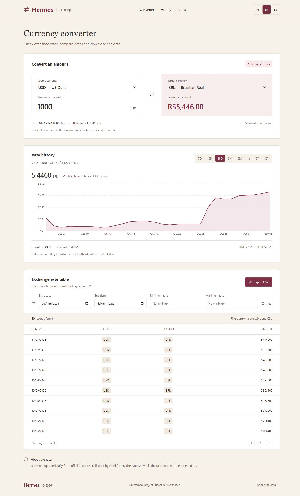
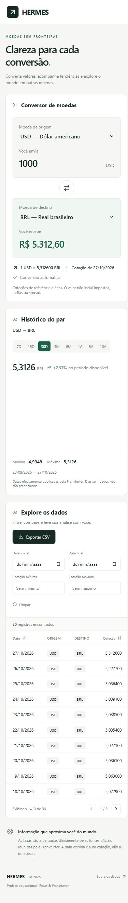

# Currency Exchange App

SPA React para conversão, histórico e exportação de moedas usando Frankfurter v2. Reconstruída em 27/10/2026 após perda dos arquivos anteriores, com assistência de IA. Os commits registram esta reconstrução.

Execução local: siga os comandos abaixo. Hospedagem não é uma exigência explícita do enunciado recebido. É necessário acesso à internet para consultar a API. A prévia hospedada anteriormente corresponde ao visual de 27/10/2026.



A captura registra a revisão anterior ao ajuste final de espaçamento e cabeçalho. O código atual utiliza o nome Currency Exchange App.

## Funcionalidades
Conversão automática, seleção/inversão de moedas, taxa e data efetiva; gráfico nos oito períodos; tabela paginada; filtros inclusivos por datas e cotação, combinados; ordenação por data/cotação; contagem; limpeza; CSV de todos os registros filtrados; loading, erro, nova tentativa e vazio. Interface responsiva em português, inglês e espanhol.

## Tecnologias
React 19, JavaScript/JSX, Vite 7, CSS Modules, Recharts, Lucide React, fetch/async/await, useState, useEffect e custom hook. Newman executa a Collection Postman. Sem back-end próprio, banco ou chave de API.

## Instalação
Node.js 22.12+ (validado com 24.19.0) e npm. Se clonar o repositório com a pasta cambio, entrar nela primeiro:

```sh
cd cambio
npm ci
npm run dev
```

Abrir o endereço exibido. Porta alternativa: `npm run dev -- --port 5187`.

```sh
npm test
npm run test:api
npm run build
npm run preview
```

test roda testes locais sem rede; test:api executa a Collection com internet; build gera dist; preview serve o build. A API é consultada pelo navegador e exige conexão.

## Arquitetura
- App: par e período compartilhados (lifting state up).
- components: Converter/CurrencySelect, History, HistoryData, QueryState.
- hooks/useFrankfurter: consultas, estados, cache de cinco minutos, cancelamento e retry.
- services/frankfurter: fetch, validação HTTP/JSON.
- utils/data: conversão, datas, filtros, sort, CSV e formatação.
- constants/periods: oito períodos.
- tests: testes Node de funções e serviço.

Valor fica no conversor; filtros/ordenação em HistoryData. Resultados são derivados, não estados duplicados. Tabela pagina em 10 linhas; CSV inclui todas as páginas filtradas. Gráfico mantém o período completo.

## Documentação
- [Requisitos](docs/REQUIREMENTS.md)
- [Componentes](docs/COMPONENTS.md)
- [Figma](docs/FIGMA.md)
- [API e Postman](docs/API_TESTS.md)
- [Testes](docs/FUNCTION_TESTS.md)
- [Collection](docs/postman/Frankfurter.postman_collection.json)
- [Resultado Newman](docs/postman/results.json)
- [Uso de IA](docs/AI_USAGE.md)
- [Board](docs/DEVELOPMENT_BOARD.md)
- [Entrega](docs/DELIVERY.md)



## Decisões e limites
Moedas iguais bloqueadas. Valor de 0 a 1 trilhão, até oito casas decimais, ponto/vírgula decimal e sem separadores de milhar. CSV UTF-8 BOM, separador ponto e vírgula, decimal com vírgula, precisão recebida. Taxas diárias de referência sem impostos/tarifas/spread. Disponibilidade histórica varia por par/fonte; não se geram dados fictícios em falhas.

[Repositório público](https://github.com/yaascarol/ProjetoCurrencyExchangeApp) e [protótipos no Figma](https://www.figma.com/design/97gW3zxOPZzLn7NJOHaivw/HERMES-%E2%80%94-Currency-Exchange-%7C-Prot%C3%B3tipos). Branches main/dev publicadas e commits reais, sem reconstrução fictícia de aulas passadas.


## Acessar e testar a API Frankfurter, passo a passo

Usamos a **API v2**, em `https://api.frankfurter.dev/v2`. A API pública não exige cadastro, token ou arquivo `.env`. Documentação oficial: https://frankfurter.dev/ (consultada em 03/11/2026).

### 1. Conhecer as moedas disponíveis

Abra no navegador ou faça uma requisição GET no Postman:

```text
https://api.frankfurter.dev/v2/currencies
```

O resultado é um array de objetos. Procure `iso_code` (código como EUR, USD ou BRL) e `name` (nome). Pode haver outros campos. Use os códigos retornados nos próximos passos.

### 2. Consultar a cotação mais recente de um par

```text
https://api.frankfurter.dev/v2/rate/EUR/USD
```

O objeto retornado contém `date`, `base`, `quote` e `rate`. `rate` indica quantas unidades da moeda de destino equivalem a **1 unidade da moeda de origem**. Confira a data retornada; não presuma que corresponde ao dia da consulta.

A aplicação calcula `valorConvertido = valorInformado * rate`. Por exemplo, uma taxa **hipotética** de 1,10 e um valor de 100 EUR resultam em 110 USD. O valor a converter não é enviado à API.

### 3. Consultar um intervalo histórico

```text
https://api.frankfurter.dev/v2/rates?from=2024-05-01&to=2024-05-31&base=EUR&quotes=USD
```

| Parâmetro | Significado | Exemplo |
| --- | --- | --- |
| `from` | Início do intervalo, formato AAAA-MM-DD | `2024-05-01` |
| `to` | Fim do intervalo | `2024-05-31` |
| `base` | Moeda de origem | `EUR` |
| `quotes` | Moeda(s) de destino | `USD` |

A resposta é um array de registros com data, origem, destino e taxa. Compare o primeiro e o último registro com o intervalo solicitado. Nosso serviço conserva somente os registros dentro do intervalo e ordena por data. A disponibilidade depende do par e das fontes: não inventamos valores para datas ausentes, nem assumimos que todo fim de semana está ausente.

### 4. Fazer essas consultas no Postman

1. Abra o Postman e crie uma requisição HTTP.
2. Selecione **GET** e cole uma das URLs acima.
3. Em **Authorization**, selecione **No Auth**. Não há corpo de requisição.
4. Opcionalmente, adicione o cabeçalho `Accept: application/json`.
5. Clique em **Send**. Confira o status HTTP, o corpo JSON e os campos descritos acima.
6. Para o histórico, use a aba **Params** para editar `from`, `to`, `base` e `quotes`. Evite duplicar parâmetros já presentes na URL.
7. Para utilizar os testes do projeto, clique em **Import**, selecione `docs/postman/Frankfurter.postman_collection.json` e importe a Collection.
8. Abra cada requisição e execute **Send**; consulte a aba de resultados dos testes. Também é possível executar a Collection inteira no Runner.
9. Registre os resultados reais em `docs/API_TESTS.md`. A evidência já disponível neste repositório foi produzida por Newman, não por uma execução na interface gráfica do Postman.

Para executar a Collection pelo terminal, dentro de `cambio`:

```sh
npm run test:api
```

Esse comando precisa de internet e grava o relatório em `docs/postman/results.json`.

### 5. Entender e testar erros

Troque uma moeda por um código inválido, por exemplo `ABC`, e observe o status e o JSON. A documentação descreve erros HTTP 400, 404 e 422; confira o status efetivamente recebido. No código, sempre verificamos `response.ok` antes de processar o resultado.

Para testar indisponibilidade no aplicativo, use o modo Offline das ferramentas do navegador e recarregue a página (o cache em memória pode evitar uma nova consulta por alguns minutos). Volte a Online e use **Tentar novamente**. Requisições que ultrapassam 30 segundos são canceladas. Não confunda falha de conexão com uma resposta vazia válida.

### 6. Encontrar a integração no código

- `src/services/frankfurter.js`: URL base, `fetch`, `async/await`, verificação HTTP e validação do JSON.
- `src/hooks/useFrankfurter.js`: consultas por par/período, cache em memória de cinco minutos, loading, erros e cancelamento.
- `src/utils/data.js`: multiplicação para conversão, períodos, filtros, ordenação e geração local do CSV.

## Idiomas

Use os botões **PT / EN / ES** no cabeçalho. A escolha é salva neste navegador quando o armazenamento está disponível. Textos, nomes das moedas, datas, números, mensagens e cabeçalhos do CSV acompanham o idioma. Códigos de moedas continuam iguais. No CSV, as datas permanecem em ISO (`AAAA-MM-DD`) para facilitar a importação e os números usam o separador decimal do idioma, sem separador de milhar.

Os dicionários ficam em `src/i18n/messages.js`; `LanguageProvider` e `useLanguage` compartilham a preferência. A troca de idioma não reinicia os filtros, o valor digitado ou o par selecionado e não provoca outra consulta à API.

## Versão do Vite

Este projeto utiliza **Vite 7**, com **7.3.7** instalado no lockfile atual. Não utiliza Vite 8. Para conferir após `npm ci`, execute `npm ls vite` dentro de `cambio`.

Os controles nativos de data (calendário do navegador) podem seguir o idioma configurado no navegador/sistema. Os rótulos e as datas exibidas pela aplicação seguem o seletor PT/EN/ES.
