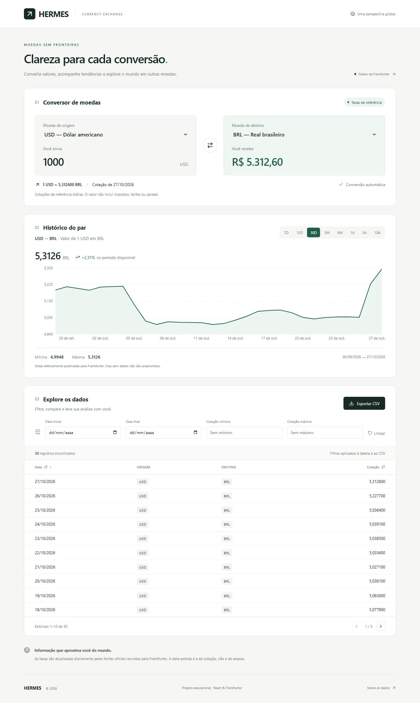
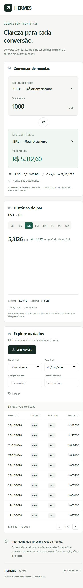

# HERMES — Currency Exchange

SPA React para conversão, histórico e exportação de moedas usando Frankfurter v2. Reconstruída em 27/10/2026 após perda dos arquivos anteriores, com assistência de IA. Os commits registram esta reconstrução.

[Prévia publicada — acesso privado](https://cambio-currency-lab-271026.hazy-cow-7421.chatgpt.site).



## Funcionalidades
Conversão automática, seleção/inversão de moedas, taxa e data efetiva; gráfico nos oito períodos; tabela paginada; filtros inclusivos por datas e cotação, combinados; ordenação por data/cotação; contagem; limpeza; CSV de todos os registros filtrados; loading, erro, nova tentativa e vazio. Interface responsiva em português.

## Tecnologias
React 19, JavaScript/JSX, Vite 7, CSS Modules, Recharts, Lucide React, fetch/async/await, useState, useEffect e custom hook. Newman executa a Collection Postman. Sem back-end próprio, banco ou chave de API.

## Instalação
Node.js 22.12+ (validado com 24.19.0) e npm. Se clonar o repositório com a pasta cambio, entrar nela primeiro:

```sh
cd cambio
npm ci
npm run dev
```

Abrir o endereço exibido. Porta alternativa: `npm run dev -- --port 5187`.

```sh
npm test
npm run test:api
npm run build
npm run preview
```

test roda testes locais sem rede; test:api executa a Collection com internet; build gera dist; preview serve o build. A API é consultada pelo navegador e exige conexão.

## Arquitetura
- App: par e período compartilhados (lifting state up).
- components: Converter/CurrencySelect, History, HistoryData, QueryState.
- hooks/useFrankfurter: consultas, estados, cache de cinco minutos, cancelamento e retry.
- services/frankfurter: fetch, validação HTTP/JSON.
- utils/data: conversão, datas, filtros, sort, CSV e formatação.
- constants/periods: oito períodos.
- tests: testes Node de funções e serviço.

Valor fica no conversor; filtros/ordenação em HistoryData. Resultados são derivados, não estados duplicados. Tabela pagina em 10 linhas; CSV inclui todas as páginas filtradas. Gráfico mantém o período completo.

## Documentação
- [Requisitos](docs/REQUIREMENTS.md)
- [Componentes](docs/COMPONENTS.md)
- [Figma](docs/FIGMA.md)
- [API e Postman](docs/API_TESTS.md)
- [Testes](docs/FUNCTION_TESTS.md)
- [Collection](docs/postman/Frankfurter.postman_collection.json)
- [Resultado Newman](docs/postman/results.json)
- [Uso de IA](docs/AI_USAGE.md)
- [Board](docs/DEVELOPMENT_BOARD.md)
- [Entrega](docs/DELIVERY.md)



## Decisões e limites
Moedas iguais bloqueadas. Valor de 0 a 1 trilhão, até oito casas decimais, ponto/vírgula decimal e sem separadores de milhar. CSV UTF-8 BOM, separador ponto e vírgula, decimal com vírgula, precisão recebida. Taxas diárias de referência sem impostos/tarifas/spread. Disponibilidade histórica varia por par/fonte; não se geram dados fictícios em falhas.

Protótipos SVG importáveis não substituem o arquivo Figma. Repositório GitHub público e link Figma ainda dependem das contas do usuário. Branches locais main/dev e commits reais, sem reconstrução fictícia de aulas passadas.

